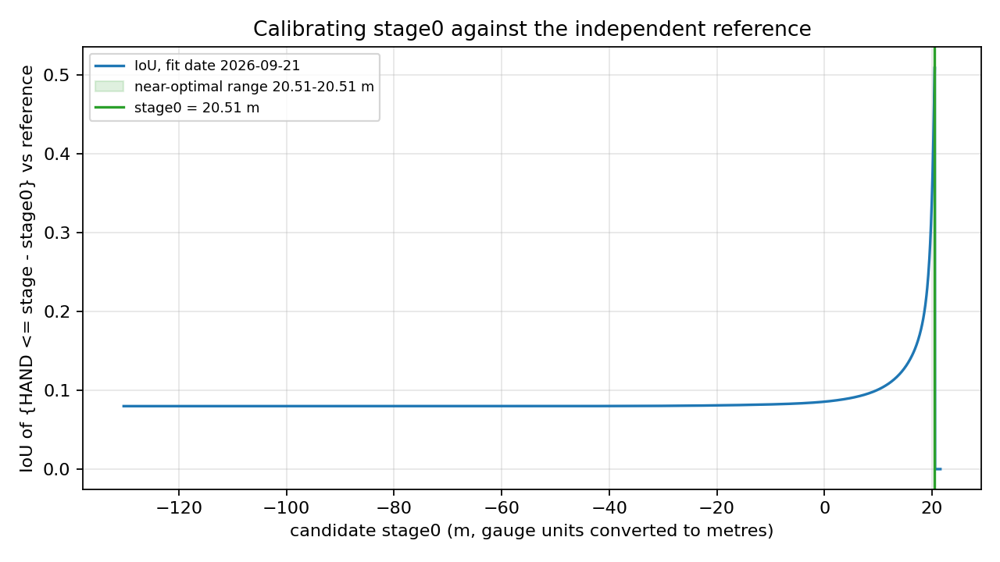
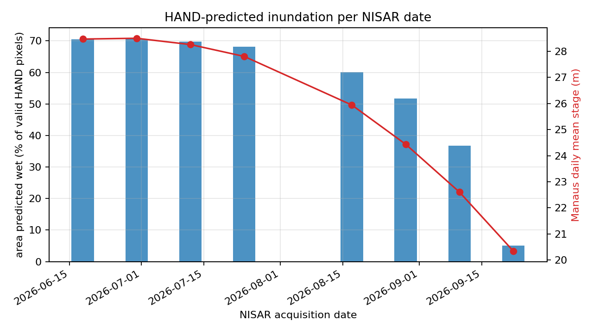

# Stage calibration: gauge height to HAND inundation (Ticket #14)

## Method

For each acquisition date the flood extent is the set of pixels whose height above the nearest
drainage (HAND) is at or below the water height on that date:

    h(date)   = stage(date) - stage0
    wet(date) = { pixel : HAND <= h(date) }

- `stage(date)` is the daily mean Porto de Manaus level from `data/gauge/manaus_daily_stage_2026.csv`.
  ANA `Nivel` is in **centimetres**; the code converts to metres (`GAUGE_CM_TO_M`) because HAND is in
  metres. Override with `--gauge-unit-to-m` if the export turns out to use other units.
- `stage0` is the gauge reading at which the floodplain waterline sits at HAND = 0. It absorbs the
  offset between the gauge zero and the HAND datum, so it is specific to this gauge and this HAND product.
- `stage0` is fixed **once**, by matching the HAND extent to an independent reference on one or two
  dates, then reused for every granule date. It is chosen to maximise the mean IoU between
  `{HAND <= stage - stage0}` and the reference (`calibrate_stage0`). The IoU is computed exactly for
  every candidate from the sorted HAND values, not by building one mask per candidate.
- Negative `h` (river below the calibrated waterline) is floored at 0: the HAND = 0 channel stays wet, the raw
  `h` is kept in the table and the row is marked `below_hand0`. A level under the channel is within the
  vertical error of 90 m HAND, so it is not read as "no water".
  Pixels with no HAND value are excluded from every metric; they are never counted as dry.

Code: `src/nisar_flood/groundtruth/stage_calibration.py`. Runner: `scripts/calibrate_stage0.py`.
Tests: `tests/test_stage_calibration.py` (synthetic terrain with a known `stage0`).

## Running it

    python scripts/calibrate_stage0.py --hand <HAND on the NISAR grid, from #13> \
        --reference 2026-09-22=<independent water mask> \
        --check 2026-06-18=<second independent mask, optional>

- `--reference` (one or two dates) is used for fitting. `--check` dates are scored with the fitted
  `stage0` but never used to fit it, so they give the out-of-sample agreement figure.
- The reference must be independent of NISAR and of HAND: a binary mask, 1 = water, 0 = not water,
  nodata = unknown. Pick dates whose gauge level brackets the range being mapped (one near the
  low-water 22 Sep granule and, if available, one near the June high-water granules).
- The fit runs on a decimated grid (`--max-pixels`, default 20 M) because the full 20 m AOI is about
  274 M pixels; the per-date masks are written at full resolution to `data/reference/hand_inundation/`.
- Outputs in `docs/evidence/`: `stage_calibration_report.json` (stage0, range, per-date agreement),
  `stage0_calibration_curve.csv`, `hand_inundation_by_date.csv`.

## Reporting the result

Quote `stage0` together with its `stage0_range_m`, not as a bare number. The range is the span of values
within 0.005 IoU of the best, so it states how tightly the reference pins `stage0` down; it can never be
tighter than the vertical resolution of HAND. If `plateau_reaches_search_edge` is true, the reference
does not bound `stage0` (or the search range is too narrow) and the value should not be used.

## Limitation (for the methods section)

HAND assumes a flat water surface that rises uniformly everywhere. Over a wide area this does not
hold: the Amazon's water-surface slope and backwater effects (the study area sits at the confluence of
the Negro and Solimoes, and the gauge is one point near it) make the true water surface drift away from
`stage(date) - stage0` with distance from the gauge. Because `stage0` is fitted to one or two dates,
its error is lowest for dates and places near those conditions and grows away from them. Labelled tiles
are therefore kept clustered near the confluence, where a single `stage0` is most defensible; where
they are not, the flat-surface approximation is stated explicitly rather than assumed away.

Further caveats that bear on how far the gold labels can be trusted:

- **Resolution.** HAND is about 90 m. The 20 m grid aligns it to NISAR; it adds no terrain detail
  (see `hand_methods.md`).
- **Canopy bias.** The canopy correction is inherited from MERIT DEM and can leave residual bias
  under dense forest, which shifts the effective `stage0` for flooded forest relative to open water.
- **Choice of reference.** An optical or C-band open-water reference does not see water under canopy.
  Calibrating on it sets `stage0` from open-water margins and can mis-place the waterline in flooded
  forest, which is the class this project cares about. State which reference was used and for which class.
- **Timing.** The gauge value is a daily mean; the NISAR overpass is around 22:25 UTC. In September the
  river fell about 0.19 m/day, so a daily mean can differ from the overpass level by roughly a
  decimetre, small next to the HAND uncertainty but not zero.
- **One gauge.** A single point gauge cannot represent the along-river slope; that is the drift above.

<!-- RESULTS:START (generated by scripts/write_calibration_results.py - do not edit by hand) -->
## Results (real data)

Generated 2026-10-20T01:05:55+00:00 by `scripts/calibrate_stage0.py` (HAND: `tiff_1.tif`).

**Independent reference.** OPERA DSWx-HLS (S2B, 2026-09-21; water = classes 1+2; cloud/shadow/snow/fill unknown) used to fit; held-out: OPERA DSWx-S1 2026-09-16 (open water only) and DSWx-HLS 2026-09-19 (S2C, 0.9% coverage).

### stage0

- `stage0` = **20.51 m** (gauge stage at which the floodplain waterline is at HAND = 0)
- Near-optimal range (within 0.005 IoU of the best): **20.51 to 20.51 m**, width 0.00 m. This is the calibration uncertainty to quote.
- Mean IoU on the fit date(s): **0.511**

### Agreement on the fit date(s)

| Date | Stage (m) | h = stage - stage0 (m) | IoU | Precision | Recall | F1 |
|---|---|---|---|---|---|---|
| 2026-09-21 | 20.56 | 0.05 | 0.511 | 0.749 | 0.616 | 0.676 |

### Agreement on held-out dates (not used to fit `stage0`)

| Date | Stage (m) | h = stage - stage0 (m) | IoU | Precision | Recall | F1 |
|---|---|---|---|---|---|---|
| 2026-09-16 | 21.54 | 1.02 | 0.304 | 0.314 | 0.912 | 0.467 |
| 2026-09-19 | 20.96 | 0.45 | 0.264 | 0.305 | 0.664 | 0.418 |

**Reading these numbers.** The reference sees open water only. HAND also predicts water under canopy (flooded forest) that the reference cannot see, so *precision* is expected to be lower than *recall*, most of all at high water. Recall (how much of the reference water HAND recovers) is the cleaner figure. IoU mixes in the flooded-forest area the reference is blind to.

### Per-date inundation prediction

| Date | Stage (m) | h (m) | Predicted wet fraction | Status |
|---|---|---|---|---|
| 2026-06-18 | 28.47 | 7.95 | 0.706 | ok |
| 2026-06-30 | 28.50 | 7.99 | 0.707 | ok |
| 2026-07-12 | 28.26 | 7.74 | 0.698 | ok |
| 2026-07-24 | 27.80 | 7.29 | 0.682 | ok |
| 2026-08-17 | 25.94 | 5.43 | 0.602 | ok |
| 2026-08-29 | 24.44 | 3.93 | 0.518 | ok |
| 2026-09-10 | 22.60 | 2.09 | 0.368 | ok |
| 2026-09-22 | 20.35 | -0.16 | 0.051 | below_hand0 |

Per-date masks (1 = wet, 0 = dry, 255 = no HAND value) are written as GeoTIFFs and kept out of git (`data/reference/` is ignored); they are regenerated by `scripts/calibrate_stage0.py`. Raw numbers: `docs/evidence/stage_calibration_report.json`, `stage0_calibration_curve.csv`, `hand_inundation_by_date.csv`.
<!-- RESULTS:END -->

## Findings and limits
- **Calibration.** `stage0` = 20.51 m, fittedon2026-09-21 against OPERA DSWx-HLS open water (classes1and 2 as water; cloud, shadow, snow and fill unknown)At the fit date the waterline is at HAND = +0.05 mCounting class 2 as not water gives the same `stage0`(2051 m). The search step is 0.05 m and thenear-optimalrange is narrower than that step, so quote+/-0.05 m asnumerical resolution, not as a fulluncertainty.
- **Agreement.** Fit date: IoU 0.51, precision 0.75recall 0.62. Held out, 2026-09-16 (OPERA DSWx-S1, rive+1.02 m): IoU 0.30, precision 0.31, recall 0.91.Heldout, 2026-09-19 (DSWx-HLS, +0.45 m): IoU 0.26precision 0.31, recall 0.66, but only 0.9% of thegridhas a valid reference, so it carries little weight.
- **Reading the held-out result.** HAND recoversalmostall reference open water (recall 0.91) butalsopredicts much that the reference does not callopenwater. This is consistent with flooded forestandfloodplain, which an open-water product cannot see,andwith the flat-water-surface assumption. Precisionfallsas the river rises above the fit level.
- **Validated range.** The reference data onlycheckwater heights up to about +1 m above the waterlinePer-date predictions at +2 to +8 m (June toearlySeptember) were not checked against any referencetreat their wet fractions as upper-end estimates.
- **Below the waterline.** 2026-09-22 has h = -0.16 mbelow the calibrated waterline. The extent is flooredath = 0 (the HAND = 0 channel), giving a wet fractionof 005.
- **Flat water surface.** The model assumes oneuniformwater surface rising with the Manaus gauge. Overa widearea the Amazon's water-surface slope andbackwatereffects cause drift, so the references andchecks usedhere are clustered near the Negro/Solimoesconfluence.This approximation should be stated in themethodssection.
